# MicroSPAT user guide

This guide takes you from a computer without MicroSPAT to exported genotypes. It covers installing the application, the guided tour inside it, a first analysis of your own plates, and the file formats that MicroSPAT reads.

If you want to see the application before you read further, install it and take the tour. The tour needs no data of your own and takes about five minutes.

> **Beta:** MicroSPAT version 3 is currently in beta. If you hit a bug or unexpected result, please report it on [GitHub](https://github.com/EPPIcenter/MicroSPAT/issues).

## What you need

To analyze a study, you need the following:

- A computer with macOS 12 or later, Windows 10 or 11, or a Linux distribution with WebKitGTK 4.1, which means Ubuntu 22.04, Debian 12, Fedora 38, or later.
- The `.fsa` files of your capillary electrophoresis runs, with a size standard in every well. MicroSPAT is built and tested for ABI 3730 instruments.
- For each marker, the dye it is labeled with, the size range in which its alleles fall, and its repeat length.
- The layout of each plate, which says which sample was amplified for which marker in each well.

To correct allele proportions for amplification bias, you also need control strains with known alleles, mixed at known proportions and run with the same panel. This part is optional.

## Install MicroSPAT

Download the installer for your operating system from the [MicroSPAT releases page](https://github.com/EPPIcenter/MicroSPAT/releases). The following table lists the file for each system:

| Operating system | File |
| --- | --- |
| macOS, Apple silicon and Intel | `MicroSPAT_<version>_universal.dmg` |
| Windows | `MicroSPAT_<version>_x64-setup.exe` |
| Linux | `MicroSPAT_<version>_amd64.AppImage` or `MicroSPAT_<version>_amd64.deb` |

The builds are not code-signed, so each operating system asks you to confirm that you trust the application the first time you open it. The following sections give the steps.

### Install on macOS

1. Open the `.dmg` file.
1. Drag **MicroSPAT** to the **Applications** folder.
1. In the **Applications** folder, double-click **MicroSPAT**. macOS says that it can't check the application for malicious software.
1. Click **Done**.
1. Open **System Settings > Privacy & Security**.
1. Next to the message about MicroSPAT, click **Open Anyway**, and then confirm.

macOS asks only once. After that, MicroSPAT opens like any other application.

### Install on Windows

1. Double-click the `setup.exe` file. Windows shows the message **Windows protected your PC**.
1. Click **More info**.
1. Click **Run anyway**.
1. Follow the installer. It installs MicroSPAT for your user account and needs no administrator rights.

MicroSPAT uses the WebView2 runtime, which Windows 11 and updated Windows 10 include. On a computer without it, the installer downloads it, which needs an internet connection. For a computer that is never online, install the [WebView2 Evergreen Standalone Installer](https://developer.microsoft.com/microsoft-edge/webview2/) first.

### Install on Linux

To install the `.deb` package on Debian or Ubuntu, run the following command in the folder that holds the file:

```sh
sudo apt install ./MicroSPAT_*.deb
```

The package registers the `.microspat` file type, so a double-click on a workspace file opens it in MicroSPAT.

To use the AppImage instead, make it executable and run it:

```sh
chmod +x MicroSPAT_*.AppImage
./MicroSPAT_*.AppImage
```

On Ubuntu, the AppImage needs the `libfuse2` package. Without it, start the AppImage with the `--appimage-extract-and-run` option.

## Start MicroSPAT for the first time

When you open MicroSPAT for the first time, it creates an empty workspace in your documents folder, at `Documents/MicroSPAT/Workspace.microspat`, and offers the guided tour.

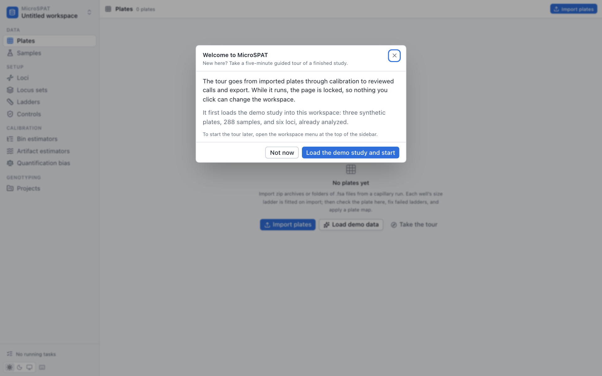

Click **Load the demo study and start** to take the tour, or **Not now** to go straight to the empty workspace. MicroSPAT makes this offer once. You can start the tour later at any time.

## Take the guided tour

The tour walks through a finished study in fewer than 20 stops, from imported plates through calibration to reviewed calls and export. At each stop it highlights one part of the screen and explains what that part is for.

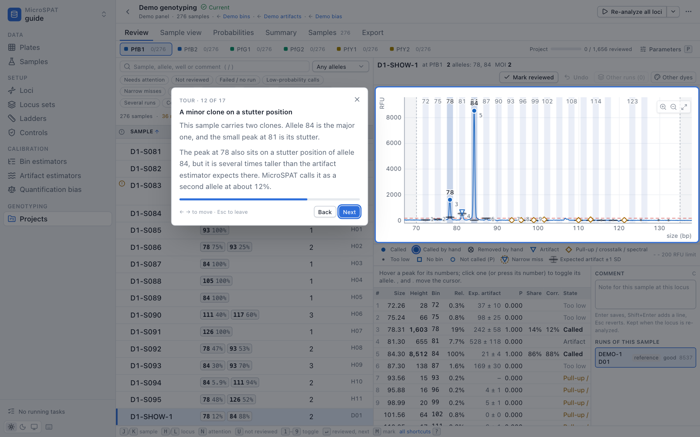

The tour runs on the demo study, a synthetic data set of three 96-well plates, 288 samples, and six loci with a finished analysis. If the workspace doesn't hold the demo study, the tour loads it first.

To start the tour, do one of the following:

- In the sidebar, click the workspace menu at the top, and then click **Take the tour**.
- In the desktop application, choose **Help > Take the Tour**.
- On the empty **Plates** page, click **Take the tour**.

To move through the tour, click **Next** and **Back**, or press the Right Arrow and Left Arrow keys. To leave, press Esc.

While the tour runs, the page behind it is locked. Clicks and keyboard shortcuts don't reach it, so the tour can't change anything in the workspace.

After the tour, the demo study stays in the workspace. Click through it, move a bin, and watch which results MicroSPAT marks as out of date. Nothing you do to the demo affects your own data, as long as you keep your own data in a separate workspace. The section "Create a workspace" describes how to make one.

To load the demo study without the tour, click the workspace menu, and then click **Load demo data**.

## How MicroSPAT is organized

MicroSPAT keeps everything that belongs to an analysis in one workspace file. Inside a workspace, the sidebar lists the pages in the order of the work:

- **Data** holds what you import, which is plates and the samples on them.
- **Setup** describes your assay: loci, locus sets, ladders, and control strains.
- **Calibration** learns allele bins, stutter, and amplification bias from your own runs.
- **Genotyping** uses all of that to call alleles.

The following table explains the terms that the pages use:

| Term | Meaning |
| --- | --- |
| Workspace | One file with the extension `.microspat` that holds the raw traces, plate maps, calibrations, calls, and your manual edits. |
| Plate | The `.fsa` files of one capillary run, with 96 or 384 wells. |
| Ladder | The size standard: its fragment sizes and its dye. MicroSPAT sizes every well against the ladder. |
| Locus | One marker, with its dye, size range, and repeat length. |
| Locus set | A named group of loci that you analyze together. Every project uses one. |
| Sample | One specimen, identified by a barcode. Samples are created from plate maps. |
| Run | One sample at one locus in one well. A sample can have several runs at a locus. |
| Bin | The size window of one allele at a locus. MicroSPAT calls a peak as an allele only when it falls inside a bin. |
| Estimator | A calibration that MicroSPAT learns from your runs. Three kinds exist: bin estimators, artifact estimators, and quantification-bias estimators. |
| Genotyping project | A set of samples, a locus set, and the estimators used to call their alleles. |
| MOI | Multiplicity of infection, the number of distinct clones in a sample. |

Two behaviors are worth knowing before you start:

- MicroSPAT saves most changes as you make them. The exceptions are drafts, which are bin edits, ladder edits, and parameter forms. A draft is saved when you click **Save** or **Apply**, and MicroSPAT asks before you leave a page that holds one.
- Results remember what they were computed from. When you change something upstream, such as a bin or a parameter, MicroSPAT marks every result that depended on it as out of date and gives the reason. Click **Re-analyze** to bring the results up to date.

## Analyze your first study

The following sections go through an analysis in order. Each step needs the ones before it. If you open a page too early, the page says which step it is waiting for and links to it.

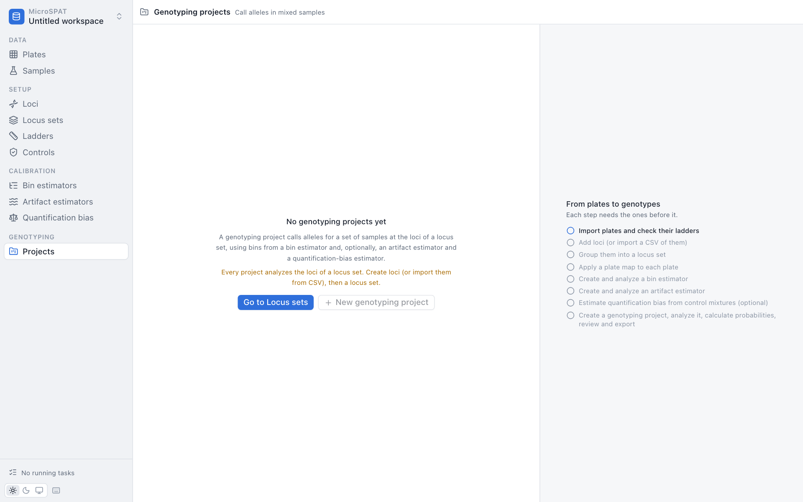

The checklist in the preceding screenshot appears beside every empty project list. It ticks each step off as you complete it.

### Create a workspace

Keep each study in its own workspace. If you took the tour in the first workspace, that workspace holds the demo study, so create another one for your data.

1. Choose **File > New Workspace**. The workspace menu at the top of the sidebar has the same command.
1. Choose a folder and a file name, and then click **Save**.

MicroSPAT opens the workspace on the empty **Plates** page.

### Import plates

1. On the **Plates** page, click **Import plates**.
1. To add plates, click **Choose or drop files** and select `.zip` archives or `.fsa` files, or click **Choose a folder** and select the folder of one plate.
1. In the **Ladder** list, select the size standard that you ran in these plates.
1. Click **Import**.

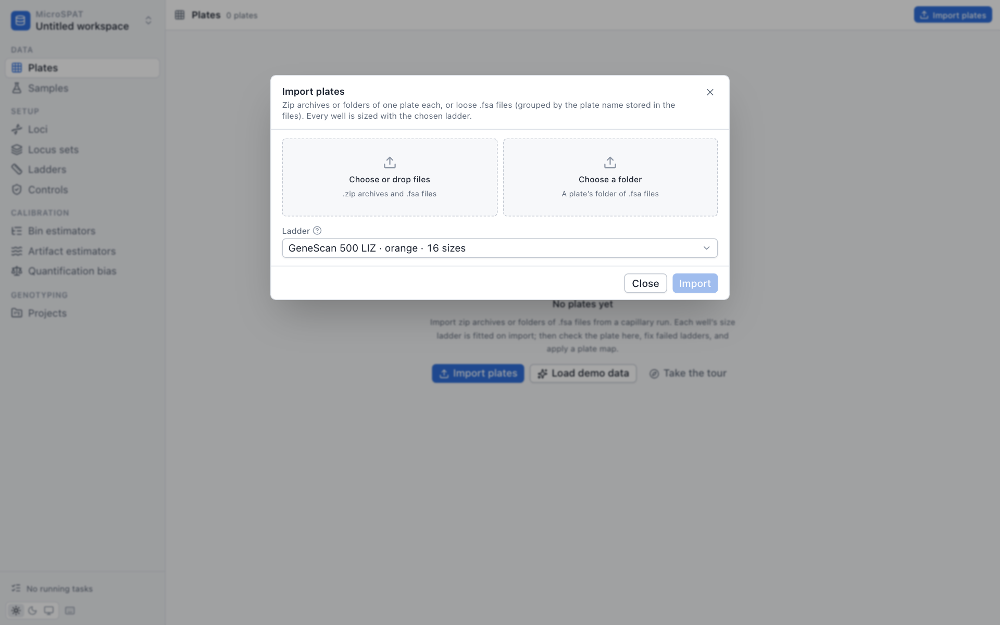

MicroSPAT groups the files into plates by the plate name that the instrument stored in each file, and sizes every well against the ladder. You can close the dialog while the import runs. The task tray at the bottom of the sidebar shows the progress.

The import lists an outcome for each plate. A plate that is already in the workspace is reported as a duplicate and left out.

If your size standard isn't in the **Ladder** list, create it first. On the **Ladders** page, click **New ladder**, enter the fragment sizes, and select the dye.

### Check the ladder of every well

Sizing is the base of everything that follows, so look at each plate before you continue.

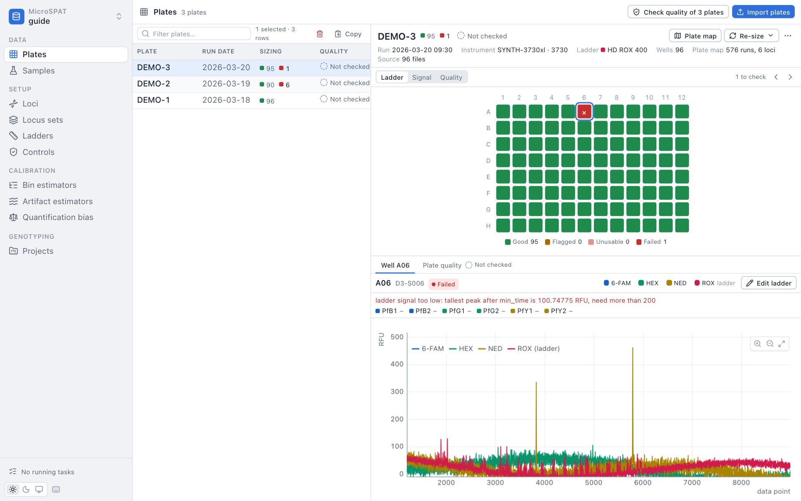

Each square of the grid is a well. The following table lists the four sizing states:

| State | Meaning |
| --- | --- |
| Good | The ladder fits within the flag limit. |
| Flagged | The well is usable but deserves a look. The fit is above the flag limit, or some loci lie outside the sized range. |
| Unusable | The ladder was fitted, but the fit can't be trusted. MicroSPAT leaves the well out of the analysis. |
| Failed | No ladder fit was possible, for example because the well has no ladder signal. |

To go through the wells that need attention, press N for the next one and P for the previous one. The line under the well name gives the reason for its state.

A well with no usable ladder signal, such as an empty or failed injection, can't be repaired. A well where MicroSPAT picked the wrong peaks can. To repair a ladder, do the following:

1. Select the well.
1. Click **Edit ladder**.
1. Click a hollow circle, or a peak in the trace, to add it as a ladder peak. To remove a ladder peak, hold Alt and click it.
1. Click **Apply**.

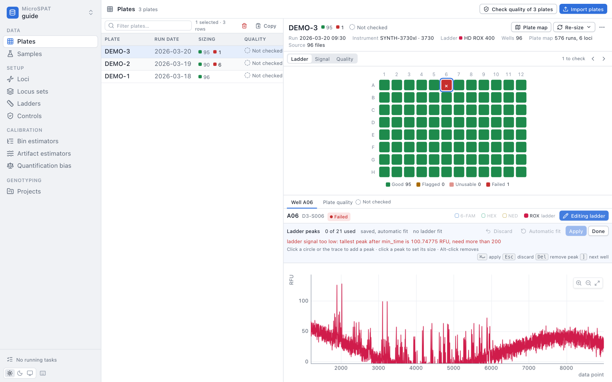

The count in the editing bar shows how many of the ladder's sizes are assigned, and the fit updates as you click. To return a well to the automatic fit, click **Automatic fit**.

If most wells of a plate fail, the plate was probably imported with the wrong ladder. Click **Re-size**, and then select the right ladder.

To check signal strength, click **Signal** above the grid. The Signal view shows each dye of each well on a scale from no signal to off-scale. Wells with weak signal and wells with off-scale signal are the usual sources of trouble in the calls.

### Check plate quality

MicroSPAT checks each plate's quality automatically when you import it. The **Quality** column in the plate list shows the worst severity found (**Problem**, **Warning**, or **Note**) and the issue count, or **No issues** when everything is within the limits.

To inspect a plate's report, open the **Plate quality** tab beside the grid, or click the quality indicator in the plate header. The report lists issues worst first, each with the numbers behind it and what to do. Click an issue to outline its wells on the grid, or click a well button in an issue card to open that well's trace. Below the issues, the panel shows the plate's dye-to-dye pull-up matrix, crosstalk between nearby capillaries, and any signal in negative controls once a plate map is applied.

To see a measure across the whole plate, click **Quality** above the grid (or press Q) and choose **Ladder height**, **Sample signal**, **Noise**, or **Spectral separation**. Wells flagged for that measure are marked with `!`.

At the top of the **Plate quality** panel, you can click **Limits** to adjust the quality thresholds in **Settings**, **Check again** to re-run the check, or **Export quality CSV** to save a CSV file with one row per well and the plate's values.

Plates from workspaces created before quality checks show **Not checked** in the plate list. Click **Check quality** in the **Plates** header (which lists how many plates need checking) to check all of them at once, or open a plate's **Plate quality** tab and click **Check quality**.

### Define loci and a locus set

1. In the sidebar, click **Loci**.
1. Click **New locus** and enter the label, dye, size range, and repeat length. To add many loci at once, click **Import CSV** instead. The section "Loci file" describes the format.
1. Select the loci that you analyze together. After a CSV import, the imported loci are already selected.
1. Click **New locus set of these**, enter a name, and then click **Create locus set**.

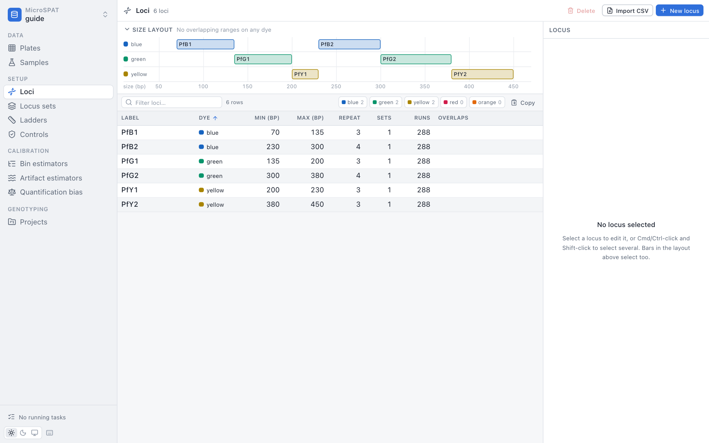

The size layout at the top of the page shows where each locus sits on its dye. Two loci on the same dye whose ranges overlap are marked, because MicroSPAT can't tell which locus a peak in the overlap belongs to.

### Apply plate maps

A plate map tells MicroSPAT which sample and which locus each well holds. It is a CSV file with a `Well` column and one column per locus. The section "Plate map file" describes the format.

1. On the **Plates** page, select a plate.
1. Click **Apply plate map**.
1. Click **Choose file** and select the plate map.
1. Read the preview. It lists what the map creates and every problem that prevents applying it.
1. If the map names samples that the workspace doesn't have, select **Create missing samples**.
1. Click **Apply**.

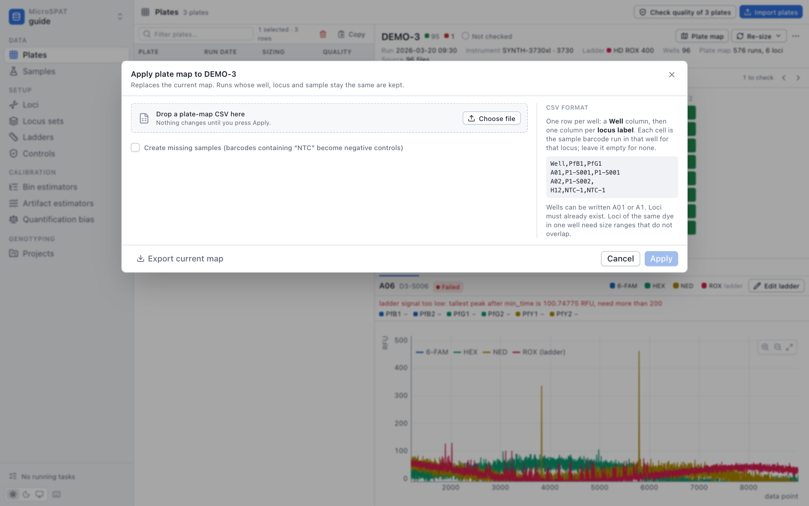

Nothing changes until you click **Apply**. Repeat the steps for every plate.

To start from a template that lists every well of the plate, click **Download template** in the dialog of a plate that has no map yet. For a plate that has a map, the same button reads **Export current map** and downloads that map.

Samples whose barcode contains `NTC` become negative controls. If a negative control shows signal at a locus, MicroSPAT flags that locus on that plate as contaminated.

### Estimate allele bins

A bin estimator looks at the peaks of all runs at a locus and clusters their sizes into bins.

1. In the sidebar, click **Bin estimators**.
1. Click **New bin estimator**, enter a title, select the locus set, and then click **Create**.
1. Click **Analyze all loci**.

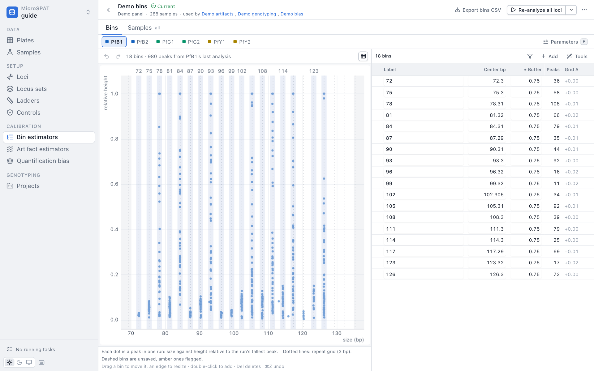

Each dot is a peak from one run, placed by its size and by its height relative to the tallest peak of its run. Peaks pile up at the allele sizes, and each shaded column is a bin.

Check every locus, because a peak outside a bin is never called. Look for piles of peaks without a bin, bins that sit off the repeat grid, and bins that cover two piles. To adjust the bins, do any of the following:

- To move a bin, drag it.
- To resize a bin, drag one of its edges.
- To add a bin, double-click empty space in the plot.
- To delete a bin, select it and press Delete.

Bin edits are a draft. To save them, press Command+S on macOS or Ctrl+S on Windows and Linux.

By default, a bin estimator uses every sample that has runs at its loci. To restrict it, open its **Samples** tab.

### Model stutter with an artifact estimator

PCR produces stutter peaks one or more repeats away from every true allele. In a mixed sample, a minor clone can sit exactly where the stutter of a major clone falls. An artifact estimator learns how tall stutter is, so that MicroSPAT can tell the two apart.

1. In the sidebar, click **Artifact estimators**.
1. Click **New artifact estimator**, enter a title, select the locus set and the bin estimator, and then click **Create**.
1. Click **Analyze all loci**.

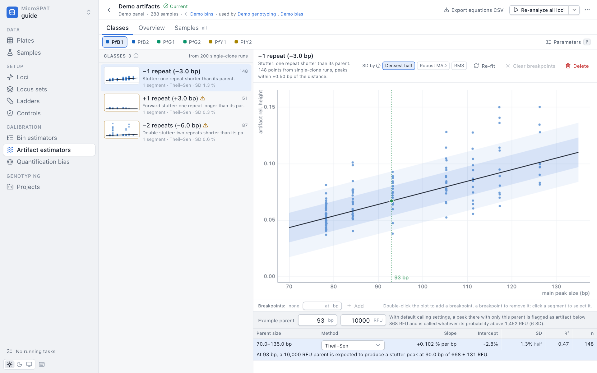

MicroSPAT finds the runs that contain a single clone and measures each kind of stutter in them, such as one repeat shorter or one repeat longer than the parent peak. For each kind it fits a line that gives the expected stutter height as a function of fragment size. The bands show one and two standard deviations around the line.

A warning sign on a stutter class means that MicroSPAT had little data for it. Read the warning before you rely on that class.

An artifact estimator is optional for a genotyping project, but without one MicroSPAT calls every peak in a bin that is above the height limits, including stutter.

### Optional: Estimate quantification bias

PCR amplifies shorter fragments more efficiently, so a short allele looks more abundant than it is. If you report within-sample allele proportions, you can measure and correct this bias with control strains mixed at known proportions. If you only report which alleles are present, skip this section.

1. Run the control mixtures on a plate, and import and map that plate like any other.
1. In the sidebar, click **Controls**, and then click **New control** for each strain. Select the bin estimator, enter the name of the strain, and select the bin of its allele at each locus.
1. In the sidebar, click **Quantification bias**.
1. Click **New quantification-bias estimator**, enter a title, select the locus set and the bin estimator, and then click **Create**.
1. On the **Control mixtures** tab, add each mixture sample with its strains and their proportions, or import them from a CSV file. The section "Control mixtures file" describes the format.
1. Click **Analyze all loci**.

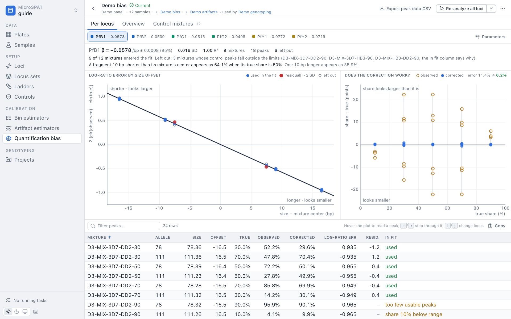

For each locus, MicroSPAT reports the bias and shows whether the correction brings the observed shares back to the true shares. The table under the plots lists every control peak and says whether it entered the fit, and if not, why.

### Genotype the samples

1. In the sidebar, click **Projects**.
1. Click **New genotyping project**.
1. Enter a title, and then select the locus set, the bin estimator, and the artifact estimator. If you made a quantification-bias estimator, select it too.
1. Click **Create**. The project opens on its **Samples** tab.
1. Click **Add samples**, and then select samples from the workspace or import a CSV file of barcodes.
1. Click **Analyze all loci**.
1. Open the **Probabilities** tab, and then click **Calculate probabilities**.

The analysis calls alleles locus by locus. The probabilities step then looks at the whole project. It estimates how common each allele is and how many clones each sample carries, and it gives every candidate peak a probability of being a true allele. Run the probabilities step again whenever you re-analyze a locus. The **Probabilities** tab shows a dot while its results are missing or out of date.

### Review the calls

The **Review** tab is where you check the calls against the traces.

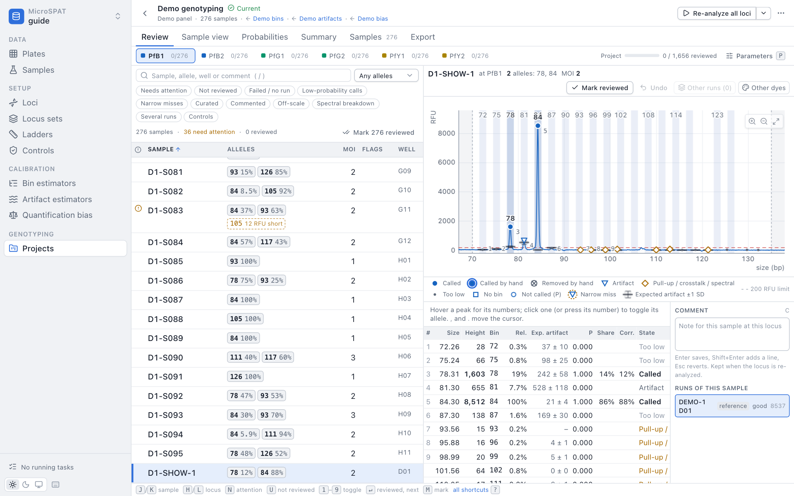

Select a locus in the strip above the table. The table lists every sample at that locus with its called alleles, their shares, and its MOI. The filters above the table narrow it to the calls that need a second look, such as low-probability calls and off-scale runs.

Select a sample to see its trace. The table under the trace lists every peak with its height, the artifact height that MicroSPAT expects at that position, its probability, and its state.

To review, do the following for each call that needs attention:

1. Compare the called alleles with the trace.
1. If you disagree with a call, click the peak in the trace or in the table to switch its allele on or off.
1. To mark the call as reviewed and move to the next sample, press Enter.

The following keys make review faster:

| Key | Action |
| --- | --- |
| J and K | Next and previous sample |
| H and L | Previous and next locus |
| N | Next call that needs attention |
| U | Next call that isn't reviewed |
| 1 to 9 | Switch the allele of the numbered peak on or off |
| Enter | Mark as reviewed and go to the next sample |
| M | Mark as reviewed, or clear the mark, without moving |
| C | Edit the comment |

A review mark stays through re-analysis as long as the call doesn't change. If the call changes, MicroSPAT removes the mark and says why.

Re-analyzing a locus discards the manual edits that you made to its calls. Comments are kept. Finish the calibration before you start to edit calls by hand.

The **Summary** tab shows the MOI distribution, the share of polyclonal samples, and the prevalence of every allele at each locus. An allele that almost no sample carries deserves a look in **Review**. It can be a rare allele, or a bin that sits in the wrong place.

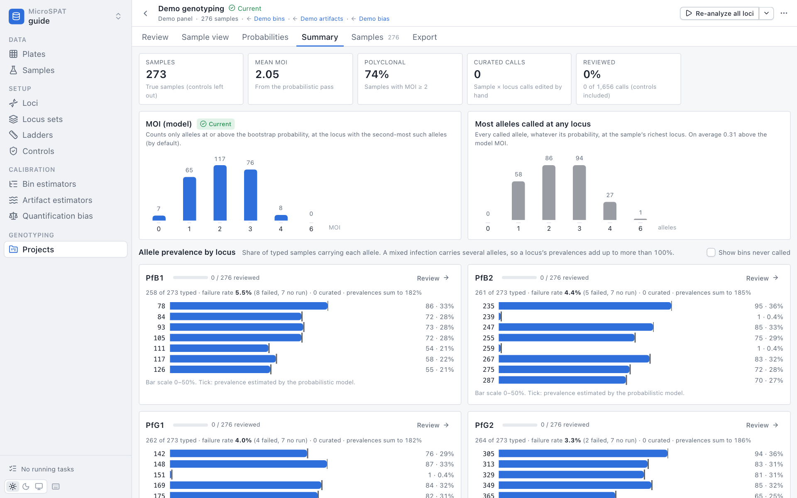

### Export the results

1. In the project, open the **Export** tab.
1. Next to the table that you want, click **Export CSV**.

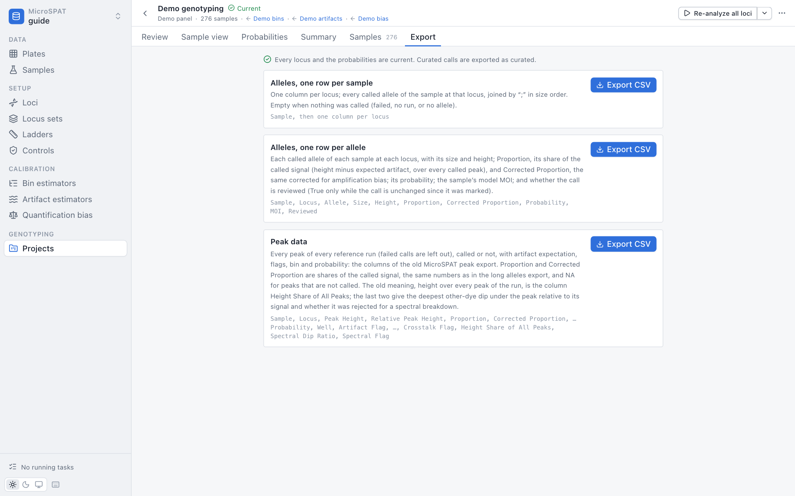

The following table describes the three files:

| File | Content |
| --- | --- |
| Alleles, one row per sample | One column per locus, with the alleles of the sample at that locus joined by `;`. |
| Alleles, one row per allele | Each called allele with its size, height, share of the sample, bias-corrected share, probability, the MOI of the sample, and whether the call is reviewed. |
| Peak data | Every peak of every run, called or not, with all of its annotations. |

The **Export** tab warns you if a result is out of date. Bring the project up to date before you export.

## Input file formats

All input files are CSV files with a header row. Examples of each file are in the `demo_files` folder of the MicroSPAT repository.

### Loci file

A loci file has one row per locus and the following columns:

| Column | Content |
| --- | --- |
| `Label` | The name of the locus. Plate maps use this name. |
| `Min. Base Length` | The lower end of the size range, in base pairs. |
| `Max. Base Length` | The upper end of the size range, in base pairs. |
| `Nucleotide Repeat Length` | The length of the repeat unit, in base pairs. |
| `Color` | The dye: `blue`, `green`, `yellow`, `red`, or `orange`. |

The following example defines two loci:

```csv
Label,Min. Base Length,Max. Base Length,Nucleotide Repeat Length,Color
L1,60,140,3,blue
L3,90,170,3,green
```

MicroSPAT checks every row before it creates anything. If one row is invalid, no locus is created.

### Plate map file

A plate map has one row per well. The first column is `Well`, and every other column is headed by a locus label. Each cell holds the barcode of the sample that was run for that locus in that well. Leave a cell empty if the well doesn't hold that locus.

The following example maps three wells of a plate with the loci `L1` and `L3`:

```csv
Well,L1,L3
A01,S001,S001
A02,S002,
H12,NTC-1,NTC-1
```

The following rules apply:

- Wells can be written as `A01` or `A1`.
- Every locus in the header must already exist in the workspace.
- Loci on the same dye in one well need size ranges that don't overlap.
- Applying a map replaces the previous map of the plate. Runs whose well, locus, and sample stay the same are kept, together with their analysis.

### Sample list file

To add samples to a project from a file, use a CSV file with a `Barcode` column:

```csv
Barcode
S001
S002
```

The same format creates samples on the **Samples** page before any plate map names them. There, an optional `Designation` column sets each sample to `sample`, `negative`, or `positive`.

### Control mixtures file

A control mixtures file has a `Barcode` column, followed by one column for each strain in a mixture. Each of those cells holds the name of a control and its proportion, separated by a semicolon:

```csv
Barcode,C1,C2
MIX-3D7-DD2-50,3D7;0.5,DD2;0.5
MIX-3D7-DD2-75,3D7;0.75,DD2;0.25
```

The following rules apply:

- Each barcode must be a sample in the workspace.
- Each control must exist for the bin estimator of the project.
- Proportions are fractions, such as `0.75`, and the proportions of a sample must add up to 1.

## Save, copy, and share a workspace

A workspace is one file, and MicroSPAT writes your work into it as you go. You don't need to save before you quit.

To make a copy of the workspace, for example as a backup before a large change, choose **File > Save Workspace As**.

To share an analysis, send the `.microspat` file. The recipient opens it with a double-click, or with **File > Open Workspace**. The file holds the raw traces, so it can be large, and it holds everything that the recipient needs to see and continue your analysis.

A workspace file contains your sample barcodes and plate names. Treat it like the data it holds.

## Settings

To open **Settings**, do any of the following:

- Click **Settings** at the bottom of the sidebar.
- In the desktop application, choose **MicroSPAT > Settings…** on macOS, or **File > Settings…** on Windows and Linux.
- Press Command+, on macOS or Ctrl+, on Windows and Linux.

The page has two tabs:

- **Workspace** holds limits saved inside the `.microspat` workspace file: **Negative controls** (contamination limit and control peak calling limit) and plate quality limits (**Spectral separation**, **Pull-up and crosstalk alerts**, and **Injection, ladder, noise, and saturation**). Click **Save** to apply your changes, which updates stored plate quality reports right away. Click **Revert** (or press Esc) to discard unsaved edits, or click **Defaults** and then **Save** to restore the default limits.
- **Application** holds preferences stored locally in the app or browser for every workspace, and changes apply immediately. It covers **Appearance** (**Light**, **Dark**, or **Follow system**), **Plates defaults** (**Default plate view**, **Default quality measure**, and **Reset panel sizes**), and **Workspace and app info** (workspace name, path, file size, contents, schema version, app version, and transport).

## Run MicroSPAT on a shared computer

MicroSPAT also runs as a server that you use from a browser, for example on a lab workstation that you reach over SSH. The server is a separate download named `microspat-server` on the releases page.

To start the server with a workspace and open it in the browser, run the following command:

```sh
microspat-server --workspace study.microspat --open
```

The server listens on `127.0.0.1:7878` and has no login. Anyone who can reach the address can read and change the workspace, so bind the server to another address with `--host` only on a network that you trust.

## Troubleshooting

The following sections cover problems that new users meet most often.

### macOS says that MicroSPAT can't be opened

The builds are not code-signed. Follow the steps in "Install on macOS" to allow the application in **System Settings > Privacy & Security**.

### The window stays blank on Linux

On a Wayland session, start MicroSPAT with the environment variable `WEBKIT_DISABLE_DMABUF_RENDERER=1`.

### Most wells of a plate fail sizing

The plate was probably imported with the wrong ladder. Select the plate, click **Re-size**, and select the right ladder. If the ladder is right and the ladder peaks are weak, open the ladder on the **Ladders** page and lower **Min peak height**, and then re-size the plate.

### A plate map is refused

The preview in the dialog lists each problem. The usual causes are a column header that isn't a locus label, loci on the same dye whose ranges overlap in one well, and barcodes that the workspace doesn't know. For unknown barcodes, select **Create missing samples**.

### An import reports a duplicate

The plate, or a well of it, is already in the workspace. MicroSPAT imports each `.fsa` file once.

### A page says that it is waiting for an earlier step

Follow the link on the page. For example, a bin estimator needs a locus set and samples with runs, and samples get runs when you apply a plate map.

### Results are marked as out of date

Something that the results depend on changed, and the notice names it. Click **Re-analyze**. In a genotyping project, calculate the probabilities again afterwards.

### A minor allele that you expect isn't called

Select the sample in **Review** and find the peak in the peak table. The **State** column says why the peak wasn't called. The usual reasons are that the peak is below the height limit, that it lies outside every bin, or that it is no taller than the stutter expected at its position. The README of the repository lists how often MicroSPAT found minor alleles of different shares in a designed mixture experiment.

## Keyboard shortcuts

Press ? on any page to see the shortcuts of that page. Shortcuts work anywhere on a page except while you type in a field.
